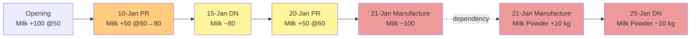
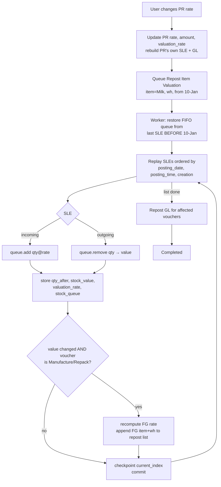

# Stock Reposting and Valuation Issue: Solution


## The task (as given)

Milk and Milk Powder both use the **FIFO** valuation method.

| Date | Transaction |
|---|---|
| Opening | Milk 100 L @ ₹50 |
| 10 Jan | Purchase Receipt: Milk 50 L @ ₹60 |
| 15 Jan | Delivery Note: Milk 80 L |
| 20 Jan | Purchase Receipt: Milk 50 L @ ₹60 |
| 21 Jan | Manufacture: consume 100 L Milk, produce 10 Kg Milk Powder |
| 25 Jan | Delivery Note: Milk Powder 10 Kg |

**Change:** the user edits the 10 Jan Purchase Receipt rate from **₹60 to ₹80**.

---

## Q1. What transactions in Stock should be affected by this change?



| Transaction | Stock ledger effect | GL effect |
|---|---|---|
| Opening | none (it is before the change) | none |
| **10-Jan PR** | incoming rate 60 → 80; value 3,000 → 4,000 | Stock In Hand / SRBNB 3,000 → 4,000 |
| **15-Jan DN (Milk)** | **its own value is unchanged (4,000)** because FIFO still consumes the @50 opening batch, but its stored running balance (4,000 → 5,000) and FIFO queue must be rewritten | none |
| **20-Jan PR** | running balance 7,000 → 8,000, queue rewritten | none |
| **21-Jan Manufacture (Milk out)** | consumes 20@50 + **50@80** + 30@60: 5,800 → **6,800** | RM credit 5,800 → 6,800 |
| **21-Jan Manufacture (Milk Powder in)** | FG rate = RM cost / qty: ₹580 → **₹680/kg** (*a different item*) | FG debit 5,800 → 6,800 |
| **25-Jan DN (Milk Powder)** | COGS 5,800 → **6,800** | COGS ↑ ₹1,000, profit ↓ ₹1,000 |

The rule: every SLE of the same item and warehouse posted at or after the edited voucher is affected, plus every SLE of each dependent item (Manufacture/Repack finished goods, transfer targets) from that dependent voucher onward.

**Net effect:** the extra ₹1,000 moves PR → Milk queue → Manufacture → Milk Powder → COGS. Closing Milk stock is still 20 L @ ₹60 = ₹1,200.

---

## Q2. How should ERPNext recalculate the valuation of the subsequent transactions?

Replay FIFO from the last known-good state. Never patch the numbers.

| Date | Txn | Queue before | Consumed | Value Δ | Queue after | Balance |
|---|---|---|---|---|---|---|
| 01 | Opening | `[]` | | +5,000 | `[100@50]` | 5,000 |
| 10 | PR | `[100@50]` | | **+4,000** | `[100@50, 50@80]` | 9,000 |
| 15 | DN | `[100@50, 50@80]` | 80@50 | −4,000 | `[20@50, 50@80]` | 5,000 |
| 20 | PR | `[20@50, 50@80]` | | +3,000 | `[20@50, 50@80, 50@60]` | 8,000 |
| 21 | SE Milk | `[20@50, 50@80, 50@60]` | 20@50 + 50@80 + 30@60 | **−6,800** | `[20@60]` | 1,200 |
| 21 | SE Powder | `[]` | | **+6,800** (6,800/10 = 680) | `[10@680]` | 6,800 |
| 25 | DN Powder | `[10@680]` | 10@680 | **−6,800** | `[]` | 0 |

Then regenerate the GL for the vouchers whose stock value changed: PR-0110, SE-0121 and DN-0125.

---

## Q3. How would you design the reposting logic for FIFO?



Design rules:

1. **Valuation is a function of history.** For a given (item, warehouse), the state at time T depends only on entries before T.
2. **Start from the previous SLE's `stock_queue`**, not from the beginning of time.
3. **Replay, never patch.** FIFO decides *which* outgoing entry consumes the re-rated batch. A "+₹1,000 on every later row" patch can't know that.
4. **Strict ordering:** `posting_date, posting_time, creation`.
5. **Dependency graph across items:** Manufacture and Repack push the new RM cost to the FG item, which gets its own repost from that voucher's time. Duplicate entries for the same item and warehouse are merged into one, starting at the earliest time.
6. **Asynchronous, resumable, idempotent.** A queued job keeps `items_to_be_repost` and `current_index` as a checkpoint, so a crashed worker can resume. Running it twice gives the same result.
7. **GL last**, and only for vouchers whose stock value actually changed. The 15-Jan DN's GL is not touched.
8. **Guards:** refuse edits that would go into frozen or closed periods, or that conflict with a repost already in progress for the same item. If the PR is already billed, the rate change belongs on the Purchase Invoice.

ERPNext v15 already works this way: `Repost Item Valuation` → `stock_ledger.repost_future_sle` → `update_entries_after.process_sle`, and `update_rate_on_stock_entry` / `recalculate_amounts_in_stock_entry` handle the FG dependency.

---

## Q4. What problems occur if every SLE stores a running balance?

ERPNext stores `qty_after_transaction`, `stock_value`, `valuation_rate` and `stock_queue` on **every** SLE. This makes reads fast (the balance is just the last row), but:

| Problem | Why |
|---|---|
| **Write amplification** | One backdated edit rewrites *every* later SLE of that item and warehouse, plus dependent items. In this example that's 6 rows; on a busy item it can be 100,000+. |
| **Cascades across items** | Manufacture, Repack and Transfer chains: Milk → Milk Powder → (a Repack into retail packs) → … |
| **Stale reads / inconsistency window** | Until the background repost finishes, stock reports, COGS and GL are wrong, and stock and accounts don't reconcile. |
| **Concurrency** | New entries posted *during* a repost read a stale previous balance. This needs row locks and queues and can cause deadlocks. |
| **Partial failure** | A crash halfway leaves half the rows old and half new. It needs checkpoints, resume and idempotency. |
| **Silent negative stock in the past** | A backdated change can make a historical balance negative even though "today" looks fine. |
| **Storage** | The `stock_queue` JSON on every row grows with the number of open batches. |
| **Closed periods** | A repost can change GL in periods already reported or filed. |
| **Self-contradictory rows if patched** | A row's queue and its value can disagree. `demo.py` shows the naive delta patch giving closing Milk = ₹2,200 (correct: ₹1,200), and Milk Powder never receives the extra cost. |

The alternative is storing only movements and computing balances when reading. That trades write cost for read cost. ERPNext's choice is stored balances plus an asynchronous, resumable repost queue.

---

## Q5. Implementation

```
erpnext-fifo-reposting/
├── README.md                 ← this file (answers Q1–Q4)
├── fifo_repost/
│   ├── engine.py             ← design: FIFO queue, SLEs with running balances, repost job
│   │                            (checkpointed), cross-item dependency, GL regeneration,
│   │                            naive patch anti-pattern (Q4)
│   └── demo.py               ← prints before/after, Q1 impact list, GL diff, Q4, crash+resume
├── tests/test_engine.py      ← 16 unit tests asserting every number above, plus a
│                                back-dated new entry and a scrap row
├── .github/workflows/tests.yml ← runs the unit tests on every push
└── erpnext_demo/
    ├── rate_change.py        ← THE CODE CHANGE for ERPNext: update_purchase_receipt_rate()
    └── run_e2e.py            ← runs the whole scenario on a real ERPNext site and verifies
                                 ERPNext's results against engine.py row by row
```

### The ERPNext code change (`erpnext_demo/rate_change.py`)

ERPNext doesn't allow editing the rate of a submitted Purchase Receipt. *Cancel + amend* fails here because cancelling the 10-Jan receipt would make the 21-Jan Manufacture go negative. `update_purchase_receipt_rate(pr, item, new_rate)` instead re-uses the revaluation path that Landed Cost Voucher already uses:

1. Validate: submitted, not billed, not frozen, no conflicting repost running.
2. Set the new rate, then `calculate_taxes_and_totals()` and `update_valuation_rate()`.
3. Rebuild the PR's own SLE and GL in place (write the cancel state, then the submit state).
4. `repost_future_sle_and_gle(force=True)` → **Repost Item Valuation** queued from 10-Jan.
5. Optionally process it now (otherwise the scheduler picks it up).
6. Add an audit comment on the PR.

Side effects and limits, worth knowing before using it outside the demo:

- The re-rated row's `price_list_rate` and discounts are cleared, so the new rate is taken as is.
- The "repost already running" check is best-effort. Item-based reposts are matched by `item_code`; voucher-based reposts leave `item_code` empty, so any voucher-based repost running for the company blocks the edit too.
- `process_now=True` runs the repost inside the web request. That's fine for the demo; in production leave it to the scheduler.

### Not modelled in `engine.py`

- **Material Transfer.** Q1's rule and design rule 5 list transfer targets as dependants because ERPNext treats them that way. The design engine only implements the Manufacture/Repack dependency, which is the one the assignment needs.

### Assumptions

- One warehouse (`Stores`), and each day's transactions posted at 10:00 (opening at 09:00).
- No taxes or additional costs on the Manufacture entry, so the finished good's cost is just the raw material consumed (minus any scrap value).
- The 10-Jan Purchase Receipt isn't billed yet. If it were, the rate change belongs on the Purchase Invoice.
- `engine.py` rounds to 6 decimal places; ERPNext uses its own precision settings.

### How to run

Requires Python 3.10+. The design engine and tests use only the standard library, so there's nothing to install.

```bash
# design engine (no ERPNext needed)
cd erpnext-fifo-reposting
python3 -m unittest discover -s tests -t .
python3 -m fifo_repost.demo

# real ERPNext, end to end (dry run: everything rolled back)
cd ~/frappe-bench   # clone this repo inside frappe-bench/: the script treats its parent folder as the bench
env/bin/python erpnext-fifo-reposting/erpnext_demo/run_e2e.py
env/bin/python erpnext-fifo-reposting/erpnext_demo/run_e2e.py --commit   # keep docs to inspect in Desk
```

`run_e2e.py` creates its own company (*Milk Repost Demo*) and a new warehouse. It disables other custom apps' hooks for its own process only, so the run behaves like vanilla ERPNext. It prints the ledger before and after, the affected transactions, the GL diff, and `VERIFY … PASS` when ERPNext's numbers match the design engine.

### Result on ERPNext v15.122

```
>>> User changes MAT-PRE-2026-00001 (Milk) rate 60 -> 80
VERIFY BEFORE: PASS - ERPNext ledger vs fifo_repost design engine
VERIFY AFTER:  PASS - ERPNext ledger vs fifo_repost design engine
Milk Powder COGS: 5800 -> 6800   |   Milk COGS (15-Jan DN): 4000 -> 4000
```
